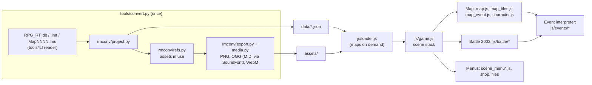

# Holy Avenger (browser remake)

A browser version of the Brazilian fan game *Holy Avenger* by Lonely Heart, originally made with
RPG Maker 2003. No RPG Maker code is involved: a Python tool converts the original project
(436 maps, database, events, graphics, MIDI music, the intro movie) into JSON and web assets,
and a vanilla JavaScript runtime written for this repo plays them, reproducing RPG_RT's
behaviour — tile maps with autotiles, events and move routes, message windows, menus with the
2003 Status screen, shops, inns, and the RPG Maker 2003 side-view ATB battle system with battler
poses, weapon overlays, troop event pages and System2 gauges.

No build step, no runtime dependencies: serve the folder over HTTP (GitHub Pages works).

## Play

```bash
python3 tools/serve.py 8091
```

Then open <http://localhost:8091>.

| Action          | Keyboard                         | Touch |
|-----------------|----------------------------------|-------|
| Move            | Arrows / WASD                    | D-pad |
| Confirm / talk  | Z, Enter, Space                  | Z     |
| Cancel / menu   | X, Esc, C                        | X     |
| Run             | Shift                            |       |

The **EN/PT** button switches the interface language. Dialogue stays in the original Portuguese;
menu and battle vocabulary switch to English.

Test entry points: `?map=12&x=5&y=7` (start on a map), `?battle=88` (start a battle with a troop),
`?party=1,2,3` (choose the party), `?seed=42` (repeatable random numbers).

## Architecture



- `js/events/interpreter.js` runs event lists; each `commands_*.js` registers its RPG Maker
  command codes in `EventCommands`.
- `js/battle/`: `rules.js` (formulas), `atb.js` (gauges), `ai.js` (enemy actions),
  `actions.js` + `action_parts.js` (one action as timed steps), `effects.js` (damage, states),
  `events.js` (troop pages, battle-only commands), `input*.js` (commands and targets),
  `windows.js`, `sprites.js`, `layout.js`, `scene*.js`.
- Engine behaviour (formulas, timings, layouts) was taken from the EasyRPG Player sources as a
  reference; the code here is new.

## Regenerating the data

```bash
scripts/setup
.venv/bin/python tools/convert.py \
  --game "/path/to/Holy Avenger" \
  --rtp "/path/to/RTP/2003" \
  --sf2 /usr/share/sounds/sf2/default-GM.sf2
```

`convert.py` detects RPG Maker 2000 vs 2003 from the database, needs Pillow and `ffmpeg`, and
renders MIDI music with `tinysoundfont` and a GM SoundFont. Assets missing from the game folder are
taken from the RTP folder(s). Three sounds the game references are not in the game or the 2003 RTP
(`Rebirth2` and two Japanese-named RTP files) and play as silence.

The bitmap fonts in `assets/font/` are RPG_RT's built-in fonts, extracted with the
`fon2png.py` tool of the sibling `saint-seiya-rpg-asgard` repo.

## Checks

```bash
scripts/check                 # unit tests (node --test), converter tests, clean-code audit
npx playwright test           # smoke + battle e2e, screenshots in e2e/screenshots/
```

## Credits and licence notes

*Holy Avenger* (the fan game) is by Lonely Heart, based on the comic *Holy Avenger* by Marcelo
Cassaro and Erica Awano. Graphics and music partly come from the RPG Maker 2003 RTP, which has its
own licence terms. This repository is a private preservation project; check those rights before
publishing it.
